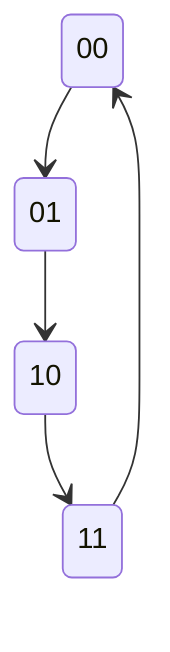

# 触发器与时序逻辑电路

> **大纲 13～14；数电习题第 6、7 章。** 重点：D／JK／T／T′，边沿波形，同步／异步状态分析，7490 内部的二分频与五进制，74LS160～163 改进制。课件第 6～7 章。

## 1. 触发器特性表与方程

$Q^n$ 表示有效时钟边沿前的现态，$Q^{n+1}$ 为边沿后的次态。以下规则在异步置位、复位均不作用时使用。

| 类型 | 输入 | 次态 | 功能 |
|---|---|---|---|
| D | $D=0/1$ | $Q^{n+1}=D$ | 保存边沿前的 D |
| JK | 00 | $Q^n$ | 保持 |
| JK | 01 | 0 | 置零 |
| JK | 10 | 1 | 置一 |
| JK | 11 | $\overline{Q^n}$ | 翻转 |
| T | 0 | $Q^n$ | 保持 |
| T | 1 | $\overline{Q^n}$ | 翻转 |
| T′ | 无控制输入 | $\overline{Q^n}$ | 每个有效边沿翻转 |

$$
Q^{n+1}_{JK}=J\overline{Q^n}+\overline KQ^n,
\qquad Q^{n+1}_T=T\oplus Q^n
$$

JK 激励表用于由现态、次态反求输入：

| $Q^n\to Q^{n+1}$ | J | K |
|---|---|---|
| $0\to0$ | 0 | X |
| $0\to1$ | 1 | X |
| $1\to0$ | X | 1 |
| $1\to1$ | X | 0 |

X 表示任意值。D 的激励就是次态，T 的激励是现态与次态的异或。

常用转换：JK 接 $J=K=1$ 得 T′；D 接 $D=\overline Q$ 得 T′；JK 接 $J=D,K=\overline D$ 得 D 触发器。

## 2. 时钟、异步端和波形题

时钟端有三角形表示边沿触发，有三角形且带小圆圈通常为下降沿。不能把电平锁存器的“使能期间跟随”用于边沿触发器。

若直接置零／置位端低有效：

| $\overline{R_D}$ | $\overline{S_D}$ | Q |
|---|---|---|
| 0 | 1 | 立即置 0 |
| 1 | 0 | 立即置 1 |
| 1 | 1 | 由时钟与数据决定 |
| 0 | 0 | 禁止／按器件规定，不能当正常互补输出 |

异步端动作不等时钟，优先于普通时钟采样。异步复位释放后也不是立即重新采样 D，而是等待后续有效边沿。

波形题按以下事件表进行：

1. 写初态，并在横轴标出该触发器的所有有效边沿。
2. 先检查边沿之间有无异步控制事件。
3. 读取每个边沿**到来前**的输入与现态，计算次态。
4. 在下一事件之前保持输出，再按输出逻辑求组合信号。
5. 多级同一时钟触发器都用旧值计算；不要先更新第一级再给第二级。

物理器件还要求满足建立时间、保持时间。题目未给延时通常按理想模型画；若输入恰好在有效边沿变化且未说明先后，应说明采样约定，不能自行断定。

T′ 输出每两个输入周期重复一次：$f_Q=f_{CP}/2$。输出经过额外与／或门形成的脉冲不一定占空比 50%。

## 3. 同步时序电路分析

同步：各存储元件由同一有效时钟边沿更新。输出可能由当前状态和当前输入共同决定。

- 时钟方程：各触发器时钟如何连接。
- 驱动方程：各 D、J/K 或 T 端的组合函数。
- 状态方程：把驱动式代入触发器特性方程。
- 输出方程：$Y=G(Q,X)$。

例：两个 D 触发器，$D_0=\overline{Q_0}$、$D_1=Q_1\oplus Q_0$，共同上升沿触发。

$$
Q_0^{n+1}=\overline{Q_0^n},\quad
Q_1^{n+1}=Q_1^n\oplus Q_0^n
$$

按 $Q_1Q_0$ 排序，状态为 $00\to01\to10\to11\to00$，是四进制加法计数器。边沿前 $01$ 时，两方程都用 $Q_0=1$，得到 $10$。

完整分析应检查全部 $2^n$ 个状态。**自启动**指从无效状态经有限次时钟进入正常循环；正常循环以外存在自锁或独立循环则不能自启动。

Moore 输出只由状态决定；Mealy 输出还依赖当前输入。状态图中 Moore 可在节点写输出，Mealy 在箭头上写“输入／输出”。

## 4. 异步时序电路分析

异步：各触发器时钟不完全相同，可能由前一级 Q 或 $\overline Q$ 驱动。

每来一个外部边沿：

1. 确定哪个触发器先得到有效时钟。
2. 算它是否翻转及翻转方向。
3. 只有下一级时钟端出现它要求的边沿，才更新下一级。
4. 逐级传播到稳定，记录稳定状态；必要时另画瞬态延迟。

**不能把异步电路所有触发器一起更新。** 下降沿触发的二分频级，以前一级 Q 作下一级时钟时可构成加法计数链；改接 $\overline Q$ 或改变触发边沿可能改变方向。

## 5. 7490／74LS90：二分频加五分频

内部有独立二分频部分和五分频部分。课件五分频输出按 $Q_DQ_CQ_B$ 可写为

$$
000\to001\to010\to011\to100\to000
$$

通常 CP 接二分频输入，$Q_A$ 接五分频输入，按 $Q_DQ_CQ_BQ_A$ 读出 8421 十进制 0～9。另一种连接把五分频输出送二分频，可得到课件 5421 排列及最高位近似 50% 占空比，必须按图确认输出位序。

成对清零控制同时有效实现异步清零，成对置 9 控制同时有效实现异步置 9；正常计数时这些控制必须保持不作用。课内常见清零／置 9 控制为高有效，不能照搬 74LS161 的低有效清零端。

## 6. 74LS160～163 的区别与功能

| 器件 | 正常计数模数 | 编码 | 清零 | 并行置数 |
|---|---:|---|---|---|
| 74LS160 | 10 | 8421 BCD | 异步 | 同步 |
| 74LS161 | 16 | 二进制 | 异步 | 同步 |
| 74LS162 | 10 | 8421 BCD | 同步 | 同步 |
| 74LS163 | 16 | 二进制 | 同步 | 同步 |

均为上升沿计数；正常控制下需两个使能端 EP、ET 同为 1 才计数。清零与装载端通常低有效，清零优先于置数，置数优先于使能计数。

| 条件 | 功能 |
|---|---|
| 清零有效 | 160/161 立即清零；162/163 在上升沿清零 |
| 清零无效、$\overline{LD}=0$ | 下个上升沿装入 DCBA，不受普通计数使能限制 |
| 清零无效、$\overline{LD}=1$、EP=ET=1 | 上升沿加 1，按本身模数循环 |
| 清零、装载无效，任一使能为 0 | 保持 |

161/163 的终端进位可写为

$$
RCO=ET\cdot Q_DQ_CQ_BQ_A
$$

160/162 正常 BCD 终端为 9（1001），RCO 在 ET 有效且终端计数时有效。RCO 是终端状态指示，不是“额外一个时钟”。

## 7. 改进制：译码 M 还是 M−1

### 异步清零法（160／161）

从 0 计数，检测 **M** 时立即清零，稳定状态为 $0,1,\ldots,M-1$。M 只是短暂到达的清零触发态。

例 161 构成模 6：检测 $0110$，低有效清零可取

$$
\overline{CR}=\overline{\overline{Q_D}Q_CQ_B\overline{Q_A}}
$$

从已知正常循环可用更简的译码，但涉及完整自启动检查时优先使用完整译码，再逐态核对。

### 同步清零法（162／163）

检测 **M−1**，使下一个上升沿清零。模 6 应在 5（0101）时令清零有效，下一拍回 0。若检测 6，就会多保留一拍，成为 7 个稳定状态。

### 同步置数法（四种器件都可）

若本身模 N，从预置 P 数到终端 K，再在下一拍装回 P：

$$
M=K-P+1
$$

常用 $K=N-1$，则 $P=N-M$。例 161 模 6，预置 10：$10\to11\to12\to13\to14\to15\to10$。

也可从 0 数到 M−1，再同步装载 0。无论选哪种，都要写实际状态序列验证，不能只背 $N-M$。

## 8. 两片 74LS160 实现模 31（习题 7-5）

先同步级联为模 100：两片 CP 接同一时钟，个位一直允许计数，个位终端进位作为十位的计数使能。高位的增加发生在低位由 9 回 0 的同一边沿。

- **异步清零**：译码十进制 31（十位 0011、个位 0001），同时接两片异步清零端。稳定序列 00～30，共 31 态。
- **同步置数**：两片装载数据均为 0000；在十进制 30 时将共同 $\overline{LD}$ 拉低，下一个边沿装 00。稳定序列同样为 00～30。
- 同步置数法若译码 31，则会把 31 也作为稳定态，得到模 32。

可定义 $E_{31}=E_{T,3}E_{U,1}$、$E_{30}=E_{T,3}E_{U,0}$，其中每个 $E$ 是完整四位相等译码；低有效端分别接 $\overline{E_{31}}$、$\overline{E_{30}}$。

## 9. 考前检查

先圈出时钟边沿和异步端；统一 $Q_D\cdots Q_A$ 的位序；同步按旧值，异步逐级传播；完整画状态图；明确清零／置数是否同步；最后数稳定状态个数。

返回 [[电子电路技术/README|复习导航]]。
